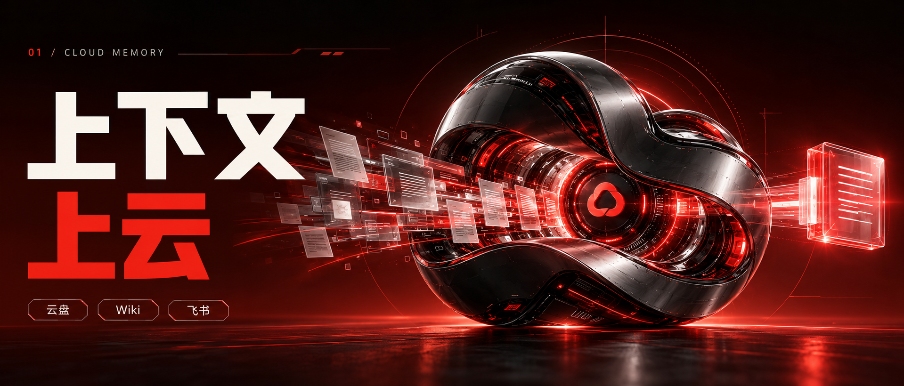
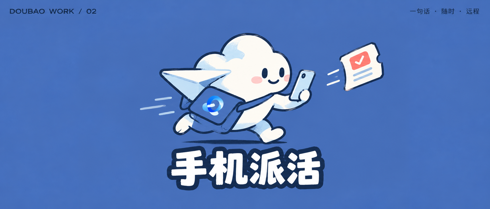
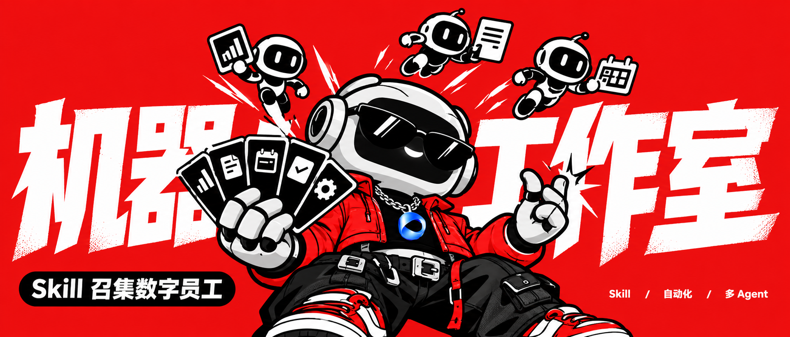
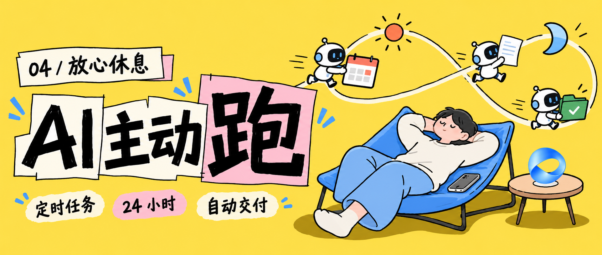
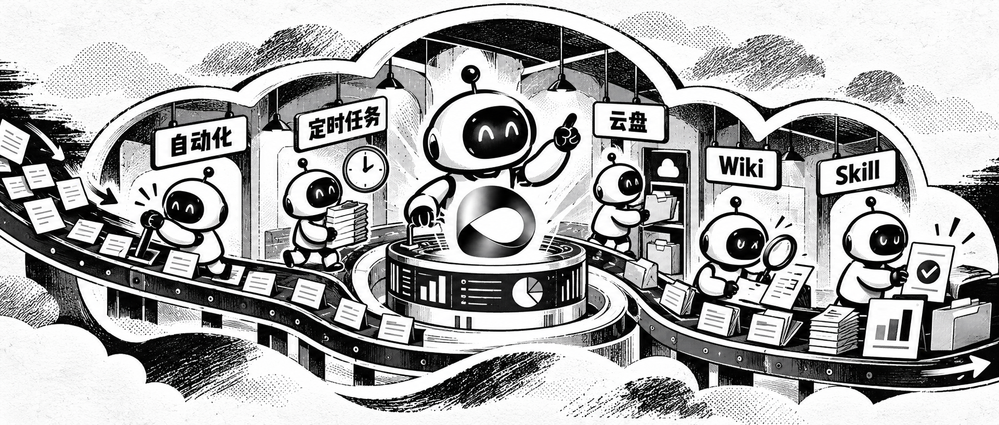
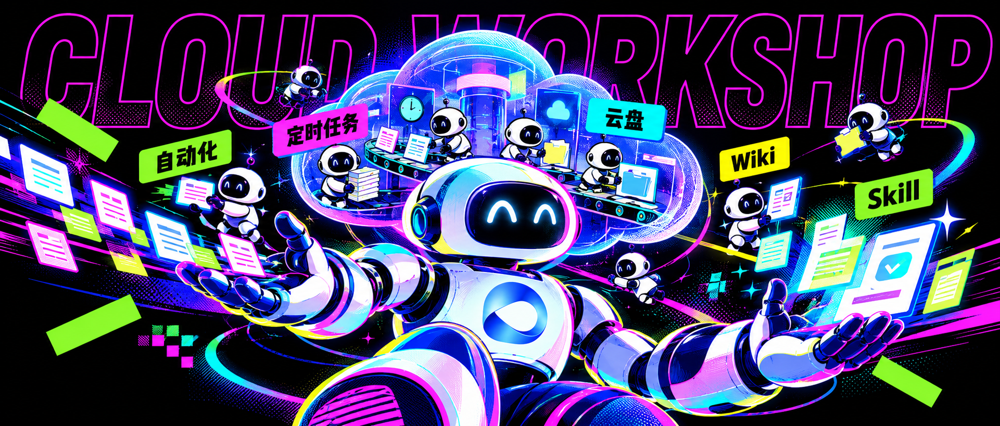
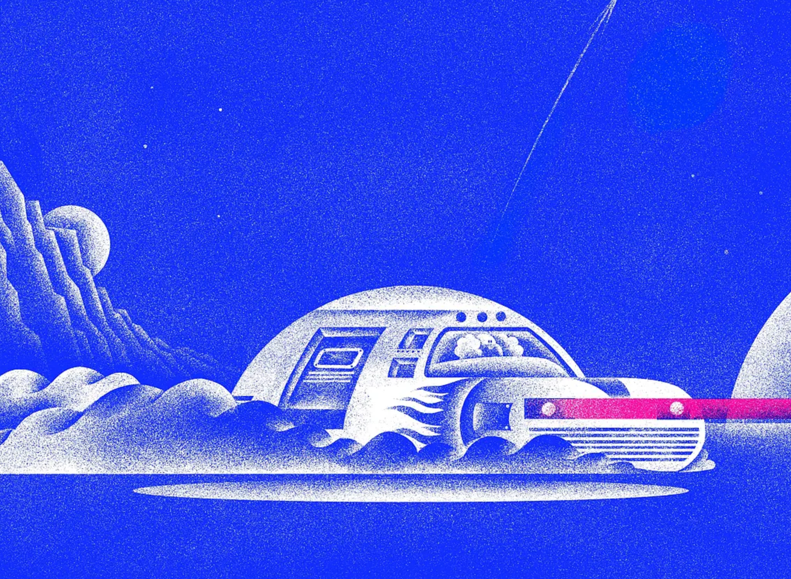
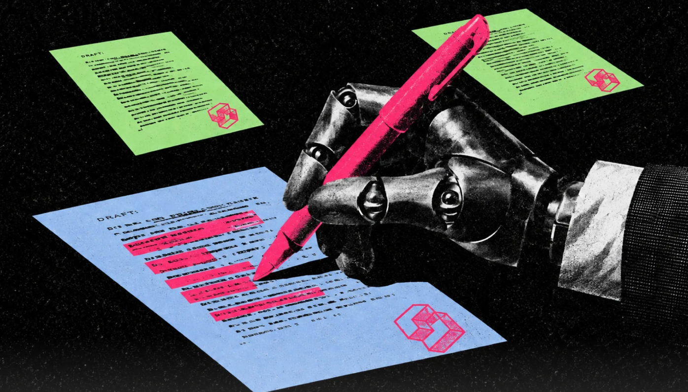
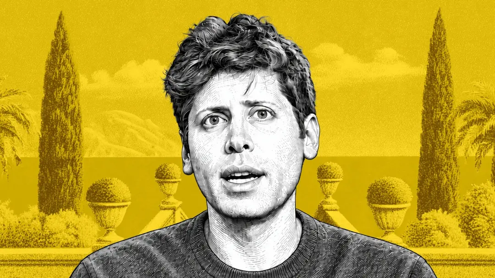

# space-image

将文章、产品概念或活动文案提炼成具有视觉隐喻的中文概念海报与公众号封面。目标不是把关键词逐个画成图标，而是用一个中心隐喻把它们串起来。

## 核心思路

把长文先变成关系，再把关系变成一个能一眼看懂的意象。

1. **提炼**：从内容中提取主题、关键词、关系句、中心隐喻、视觉冲突五项。
2. **选风格**：九套构图语法，按内容气质匹配，不套版、不同构换色。
3. **出图**：`2.35:1` 横版，默认 1920 × 817，前景大字作为空间造型，纯色/近纯色背景。

## 默认规格

- 画幅：横版 `2.35:1`（约 1920 × 817 px）
- 用途：公众号头图、文章封面、产品概念海报
- 文字：只保留标题和最多 2–4 个短标签；允许少量大字作前景造型
- 背景：纯色或近纯色，不使用廉价渐变、模板化卡片墙

## 九套构图语法

| 风格 ID | 内容气质 | 效果图 |
|---|---|---|
| `premium-black-chrome` | 系统、工程、数据、战略、能力升级 |  |
| `minimal-mascot` | 单一动作、品牌角色、轻产品表达 |  |
| `streetwear-character` | 发布、技能、团队、强态度、年轻化 |  |
| `lifestyle-handdrawn` | 日常办公、教程、人的轻松感、生活场景 |  |
| `monochrome-print-workshop` | 工作流、复杂系统、工坊、抽象概念 |  |
| `fluorescent-black` | AI、自动化、未来感、活动视觉、强冲击 |  |
| `cobalt-riso-narrative` | 超现实叙事、探索、旅行、未来生活、复古科技 |  |
| `acid-xerox-collage` | 写作、审校、研究、开发者活动、复古数码与观点表达 |  |
| `spot-color-engraved-portrait` | 人物访谈、创始人、个人观点、人物故事与个人品牌 |  |

## 目录结构

```text
space-image/
├── SKILL.md                     # Skill 主文档：工作流程、提示词组织、质量检查
├── agents/openai.yaml           # Agent 元信息
├── assets/                      # 九套风格样张（含 cobalt-riso 横竖两版、acid-xerox 两手图）
└── references/style-guide.md    # 九种风格的完整视觉语法指南
```

## 使用方式

在支持 Skill 的环境中加载本目录，调用 `space-image` 即可。默认输出横版 `2.35:1` 概念封面；指定风格或提供参考图时按内容匹配最近的构图语法。

详见 [SKILL.md](SKILL.md) 与 [references/style-guide.md](references/style-guide.md)。
